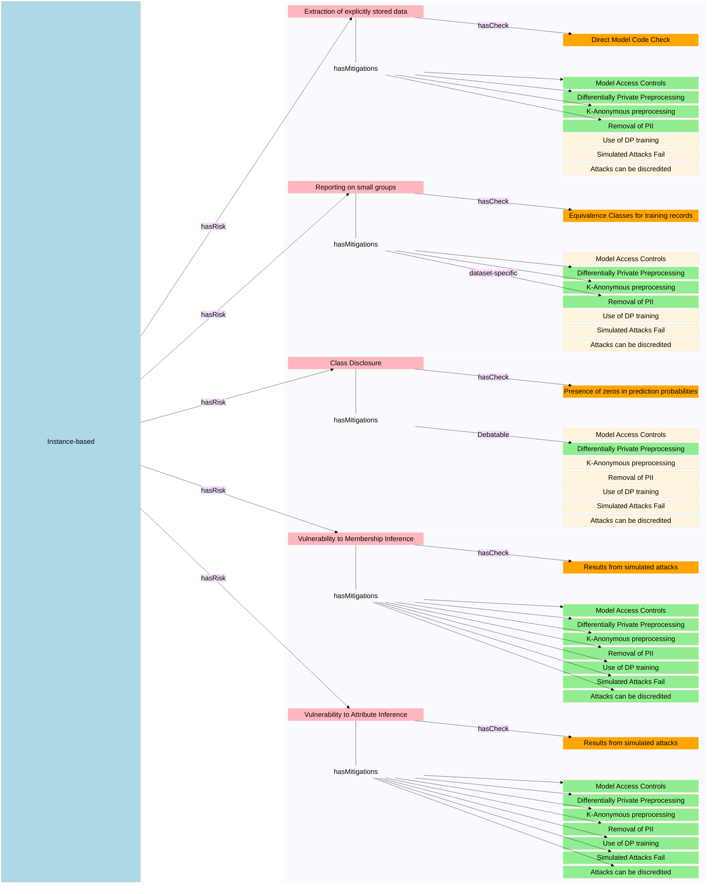
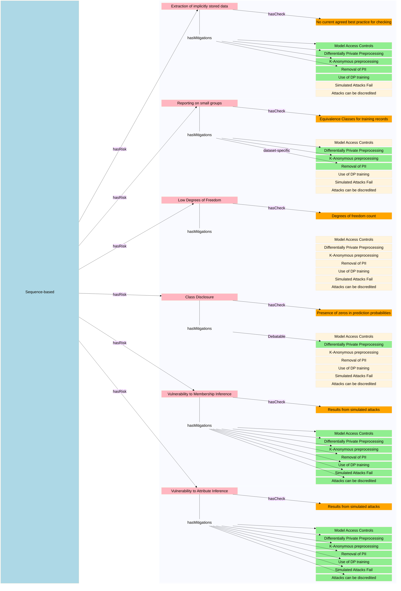
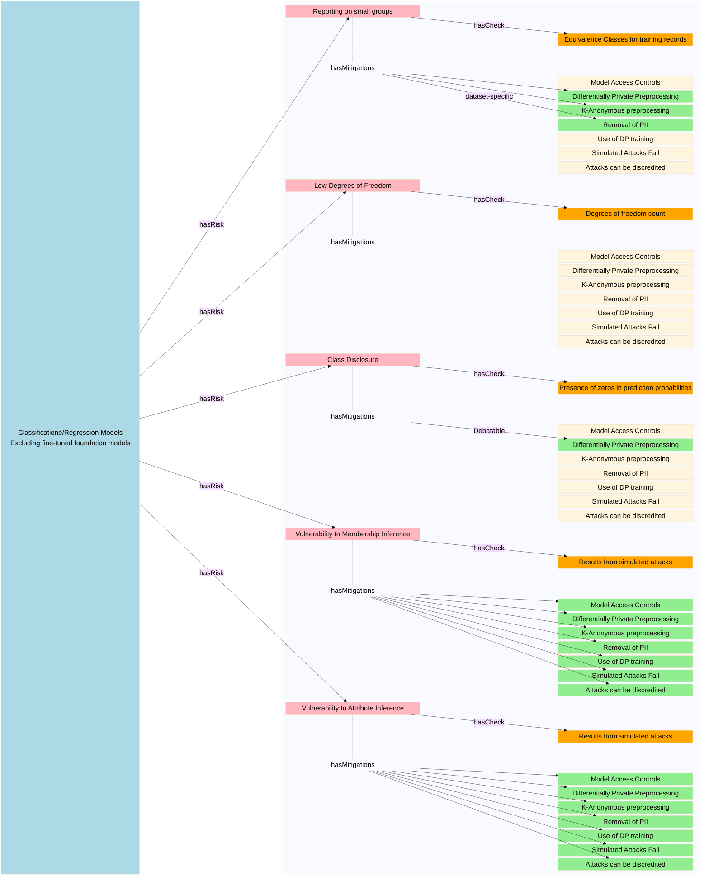

# Extending the statbarn to cover AI models trained on sensitive data

## TO-DOs
- add mitigation of restricting model capacity (via hyper-params or safe model wrappers)
- add operational measures

## Purpose and Core Concepts
This document aims to capture aspects of the disclsoiure control process for AI models trained on sensitive data.

It uses the concepts and relationships from the "Statbarns" framework as formalised in the statbarnsdc ontology [w3id.org/statbarnsdc](w3id.org/statbarnsdc)

Namely that types of output or models cabn be grouped into families - statbarns- which share vulnerability common sets of risks. 
- Each **statbarn** will typically be associated with a specific, different  combination of risks.
- Each **risk** is associated with:
    -  one or more checks
    - one or more potential mitigations.
- Each **check** has associated **evidence** and a threshold (_organisationalMeasure_)
- A **mitigation** might:
    - have its own _organisationalMeasure_ (e.g. rounding base, $\epsilon$ value for Differential Privacy) 
    - mitigate several risks.
    - reduce the **likelihood** or the **impact** of that risk occurring.

## AI-Statbarns
---

| Name | shorthand | Description | Examples | uri |
| ---| --- | --- | --- | --- | 
| Instance Based Models | `Category A'| Models that make predictions  via comparison to stored data | _K-Nearest Neighbours_,   _Support Vector Machines_ | tbc| 
| Sequence Based Models | `Category B'| Models that predict based on a sequence  of previous inputs and predictions |_Generative AI_   _Recurrent Neural Networks_ |tbc| 
| Classification Models |`Category C1'|Models that predict one (or more) categorical label(s) for a record   independently of any other predictions they make | _DecisionTreeClassifier_, _XGBoostClassifier_, _MLPClassifier_ | tbc|
| Regression Models |`Category C2'|Models that predict one (or more) numerical value(s) for a record   independently of any other predictions they make | _DecisionTreeRegressor_, _XGBoostRegressor_, _MLPRegressor_ | tbc|
|Semi-Structured predictors|`Category C3'|Models that predict one (or more) numerical value(s) for a record   independently of any other predictions they make | _YOLO Object detection/segmentation_  | tbc|

## AI Risks
|Name | Shorthand | Description | uri |
|---|---|---|---|
|Extraction of  explicitly  stored training data |explicit| Model directly embeds traing data   that can be trivially extractecd| tbc|
|Extraction of  implicitly   stored data| implicit|Some inputss may "trigger" model to "regurgutate" training records|tbc|
|Class Disclosure| class disclosure | standard definition  can manifest as model partitioning   data space so that all records in a group  have zero probability of certain labels| https://w3id.org/statbarnsdc#ClassDisclosure|
|Small group reporting |small groups | extension of risk from tables where cells haveve low counts |https://w3id.org/statbarnsdc#LowCount|
|Low Residual Degrees of Freedom |LowDoF | The risk that a model with high numbers of parameters   relative to size of training data  may simply memorise records |https://w3id.org/statbarnsdc#LowDOF|
|Membership Inference| MIA |The risk thgat an attacker   armed with a complete record and the trained model,  can infer that the record was part of the training set | tbc|
|Attribute Inference |AIA| The risk that an attacker   armed with a partial record and a trained model   can infer missing details   with higher probability for training records   than unseen records |tbc|

## Mitigations
In the below *raw data* refers to data as provided by the TRE, *training data* refers to data in the format as presented to the model (and hence vulnerable to attack). 

| Name | What does  mitigation reduce? | Description |uri | organisationalMeasures |Constraints/Notes |
| ---- |---|---|---|---|---|
|Model access controls | Likelihood   $\text{impact}^\dagger$ |Model is deployed to controlled server   with access limited to 'whitelisted' addresses   and 'query throttling' |tbc| (1) whitelist,  (2) throttling rates | 
| DP preprocessing |Impact| Raw data is transformed using a **non-invertible** DP algorithms   prior to presentation to model   so that data extracted from models cannot be `reverse engineered' | tbc| (1) $\epsilon$ (2) $\delta$ (for some implementations) |  privacy guarantees are at *record-level*   so data cannot contain multiple records from same person   Setting of $\epsilon$ is non-trivial$\dagger \dagger$|
| $K$-anonymity |Impact| Preprocessing  introduces a  mapping from 'raw' data to training data   which is at least $K \rightarrow 1$ | tbc | $K$ |privacy guarantees are at *record-level*   so data cannot contain multiple records from same person|
| PII removal | Impact| Preprocessing removes all direct **or indirect** personal identifiers.  Thus even though unique training records could be extracted   they could not reasonably be traced to individuals | - | -|Requires agreement with TRE on a dataset-specific basis|
|Differentially Private training | Likelihood| Use of a DP optimiser during model training | tbc |  (1) $\epsilon$ (2) $\delta$ (for some implementations) |privacy guarantees are at *record-level*   so data cannot contain multiple records from same person    Setting of $\epsilon$ is non-trivial $\dagger \dagger$|
|Failure of simulated inference attacks|Likelihood| Suite of simulated attacks not statistically better than random guessing   **and** same records are not consistently identified by most attacks|tbc|(1) selection of attacks, (2) selection of metrics  (e.g. AUC, TPR@lowFPR), (3) $\alpha$- probability threshold   for rejecting "null hypothesis"   that attack is doing no better than random guessing (4)computational budget   (decides what attacks can be run) |'strength' of attacks depends on compute    typical relies on estimating upper bound of vulnerability  by exploiting 'worst-case' scenario of maximum knowledge of datasets|
|Discrebitability of MIAs| Impact|Domingo Ferrer et al (ESORICS) identify a mitigation based only on the nature of the training data  regardless of attack.   In some cases, even if it can be inferred that a record must have been present in the training set,  that cannot be mapped back to a unique individual.| tbc |(1) $n$: minimum 'arity' of mapping of values to quasi-identifers   (2) Organisational attitude? (applies equally to other SDC risks) |data is tabular **and**  data is a sample of records available **and**  the mapping from 'confidential attribute values' to 'quasi identifer values'  is $n:1$ with $n >1$ for all quasi-identifer values| 

Notes:
- $\dagger$ : Arguments about impact for Model Access Controls are that potential release would only be to selected audience, e.g. clinicians within trust boundary. However that could still violate organisational data protection policies 
- $\dagger \dagger$ Privacy guarantee ($\epsilon$) depends on combination of (i) adding noise to groups (batches) of records and (ii) 'clipping' the influence of individual records. Improper settings can satisfy $\epsilon$ values but still leave models/embeddings vulnerable to attack.

## Checks
| Name | What risk(s) does the check measure | Description |uri | organisationalMeasures |Constraints/Notes |
| ---- |---|---|---|---|---|
|Equivalence classes   in model outputs  for training data | Small group reporting | tbc| - |tolerance to two outputs to be considered identical |can be done explicitly for tree-based models   more generally by grouping output probabilities |
|Presence zeros in predicted probabilities| Class Disclosure | A classifier predicting zero probability   for a label for group of records    |tbc|min. tolerance for prob(label)  to be considerdd non-zero|This is equivalent to a table where one or more cells are empty|
|DoF count|Low Residual Degrees of Freedom| Counts and compares model parameter count   vs. training set size.|tbc| minimum residual  DoF | Same as  applied to 'traditional' regression models|
|Generalisation Gap|Membership Inference|Difference between losses on training and test sets.  One measure of **over-fitting**. | tbc |max threshold |Typically a **sufficient but not necessary** condition for MIA vulnerability. i.e  reason to reject but not to accept an egress request.|
|Direct model code check|Extraction of explicitly stored training data|Directly accessing model attributes in code  e.g. `print(my_SVC.support_vectors_)` |tbc |- |-| 
|Simulated Attack Results| Extraction of implicitly stored  MIA/AIA | Results from running simulated attacks. |tbc |choice of metrics  |tbc|
---

**Open Question: better to frame "failure of simulated attacks" as a check? or a mitigation with an associated check?**

## Relationship matrices

|  Statbarn|Risk     | Extraction of  explicitly  stored training data | Extraction of  implicitly  stored training data| Small group   reporting | Class  disclosure | Low Degrees  of Freedom| Membership  Inference | Attribute   Inference |  
|---          |---         |---                                                    |---                                                   |---                         |---                   |---                        |---                       |---                       |
|Instance-based|           |Y                                                      | -                                                    |Y                           |Y                     |-                          |Y                         |?                         |
|Sequence-based|           |-|Y|?|Y|Y|Y|?|
|Classifiers   |           |-|-|Y|Y|Y|Y|Y|
|Regressors    |           |-|-|?|?|Y|Y|Y|
|Semi-structured outputs||-|-|?|?|Y|?|?|

|  Mitigation|Risk   Nature | Extraction of  explicitly  stored training data | Extraction of  implicitly  stored training data| Small group   reporting | Class  disclosure | Low Degrees  of Freedom| Membership  Inference | Attribute   Inference |  
|---            |---              |---                                                    |---                                                   |---                         |---                   |---                        |---                       |---                       |
|Model Access Control | Likelihood **and**  impact $\dagger$| Y                        |Y                                                     | N                          | N                    | N                         | Y                        | Y                        |
| DP preprocessing.   |Impact.    | Y                                                     | Y                                                    | Y (in theory)              | disputed             | N                         | Y                        |Y                         |
| $K$-anonymity       |Impact.    | Y                                                     | Y                                                    | Y                          | N                    | N                         | Y                        | Y                        |
| PII removal         |Impact.    | Y                                                     | Y                                                    | N                          | N                    | N                         | Y                        |Y                         |
|DP training          |Likelihood | -                                                     | Y                                                    | Y (in theory?)             | disputed             | N                         | Y                        | Y                        |
|Failure of simulated attacks|Likelihood| -                                               |  $Y ^{\dagger\dagger\dagger}$                        | -                          | -                    | -                         | $Y^{\dagger\dagger}$     | $Y^{\dagger\dagger}$     |
|Discreditability.    | Impact    | -                                                     | -                                                    | -                          | -                    | -                         | Y                        | Y                      |

Notes: 
- $\dagger$ : Arguments about impact for Model Access Controls are that potential release would only be to selected audience, e.g. clinicians within trust boundary. However that could still violate organisational data protection policies 
- $\dagger \dagger$ : Membership and Attribute Inference Attacks for 'standard ML' (label prediction for each record is independant of other predictions) are reasonably well understood. The extension to sequence-based models e.g.  Generative AI is a highly active research topic with no current consensus on best practice.
- $\dagger\dagger\dagger$ : the measurement of, and defences against the risk that some prompts may induce Generative AI models to 'regurgitate' training data is a highly active research topic with no current consensus on best practice.

---

# Draft Knowledge Graph for instance-based models

---
 # Draft Knowledge Graph  for sequence-based models

---

 # Draft Knowledge Graph  for Classifiers/Regressors

 
 ____

