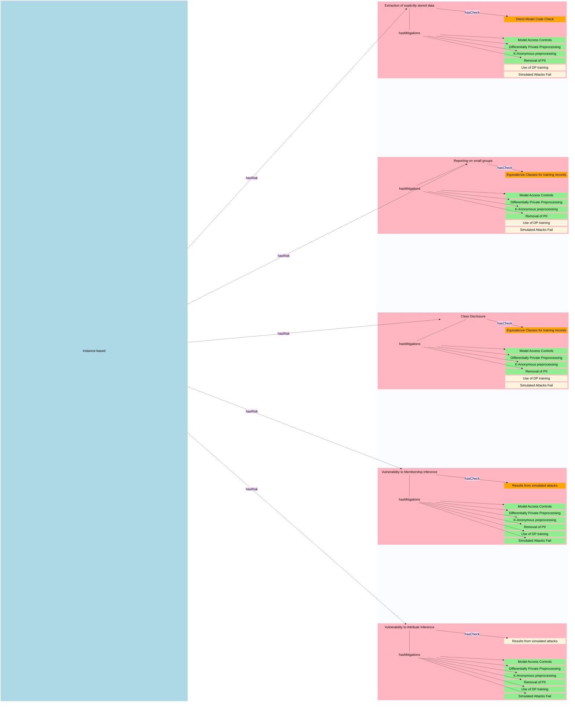

# Extending the statbarn to cover AI models trained on sensitive data

## Purpose and Core Concepts
This document aims to capture aspects of the disclsoiure control process for AI models trained on sensitive data.

It uses the concepts and relationships from the "Statbarns" framework as formalised in the statbarnsdc ontology [w3id.org/statbarnsdc](w3id.org/statbarnsdc)

Namely that types of output or models cabn be grouped into families - statbarns- which share vulnerability common sets of risks. 
- Each **statbarn** will typically be associated with a specific, different  combination of risks.
- Each **risk** is associated with:
    -  one or more checks
    - one or more potential mitigations.
- Each **check** has associated **evidence** and a threshold (_organisationalMeasure_)
- A **mitigation** might:
    - have its own _organisationalMeasure_ (e.g. rounding base, $\epsilon$ value for Differential Privacy) 
    - mitigate several risks.
    - reduce the **likelihood** or the **impact** of that risk occurring.

## AI-Statbarns
---

| Name | shorthand | Description | Examples | uri |
| ---| --- | --- | --- | --- | 
| Instance Based Models | `Category A'| Models that make predictions  via comparison to stored data | _K-Nearest Neighbours_,   _Support Vector Machines_ | tbc| 
| Sequence Based Models | `Category B'| Models that predict based on a sequence  of previous inputs and predictions |_Generative AI_   _Recurrent Neural Networks_ |tbc| 
| Classification Models |`Category C1'|Models that predict one (or more) categorical label(s) for a record   independently of any other predictions they make | _DecisionTreeClassifier_, _XGBoostClassifier_, _MLPClassifier_ | tbc|
| Regression Models |`Category C2'|Models that predict one (or more) numerical value(s) for a record   independently of any other predictions they make | _DecisionTreeRegressor_, _XGBoostRegressor_, _MLPRegressor_ | tbc|
|Semi-Structured predictors|`Category C3'|Models that predict one (or more) numerical value(s) for a record   independently of any other predictions they make | _YOLO Object detection/segmentation_  | tbc|

## AI Risks
|Name | Shorthand | Description | uri |
|---|---|---|---|
|Extraction of  explicitly  stored training data |explicit| Model directly embeds traing data   that can be trivially extractecd| tbc|
|Extraction of  implicitly   stored data| implicit|Some inputss may "trigger" model to "regurgutate" training records|tbc|
|Class Disclosure| class disclosure | standard definition  can manifest as model partitioning   data space so that all records in a group  have zero probability of certain labels| https://w3id.org/statbarnsdc#ClassDisclosure|
|Small group reporting |small groups | extension of risk from tables where cells haveve low counts |https://w3id.org/statbarnsdc#LowCount|
|Low Residual Degrees of Freedom |LowDoF | The risk that a model with high numbers of parameters   relative to size of training data  may simply memorise records |https://w3id.org/statbarnsdc#LowDOF|
|Membership Inference| MIA |The risk thgat an attacker   armed with a complete record and the trained model,  can infer that the record was part of the training set | tbc|
|Attribute Infgerence |AIA| The risk that an attacker   armed with a partial record and a trained model   can infer missing details   with higher probability for training records   than unseen records |tbc|

## Mitigations
In the below *raw data* refers to data as provided by the TRE, *training data* refers to data in the format as presented to the model (and hence vulnerable to attack). 

| Name | What does  mitigation reduce? | Description |uri | organisationalMeasures |Constraints |
| ---- |---|---|---|---|---|
|Model access controls | Likelihood |Model is deployed to controlled server   with access limited to 'whitelisted' addresses   and 'query throttling' |tbc| whitelist, throttling rates | 
| DP preprocessing |Impact| Raw data is transformed using a **non-invertible** DP algorithms   prior to presentation to model   so that data extracted from models cannot be `reverse engineered' | tbc| $\epsilon$ | privacy guarantees are at *record-level*   so data cannot contain multiple records from same person|
| $K$-anonymity |Impact| Preprocessing  introduces a  mapping from 'raw' data to training data   which is at least $K \rightarrow 1$ | tbc |$K$ |privacy guarantees are at *record-level*   so data cannot contain multiple records from same person|
| PII removal | Impact| Preprocessing removes all direct or indirect personal indentifies.  Thus even though unique trainin g records could be extracted they could not reasonably be traced ot individuals | - | -|Requires agreement with TRE on a dataset-specific basis|
|Differentially Private training | Likelihood| Use of a DP optimiser during model training |tbc| |$\epsilon$ |privacy guarantees are at *record-level*   so data cannot contain multiple records from same person|
|Failure of simulated attacks|Likelihood| Suite of simulated attacks not statistically better than random guessing   **and** same records are not consistently identified by most attacks|tbc|selections of attacks,  probability threshold computational budget |'strength' of attacks depends on compute   typical relies on estimating upper bound of vulnerability by exploiting 'worst-case' scenario of maximum knowledge of datasets|

**Open Question: better to frame "failure of simulated attacks" as a check? or amitigation with an associated check?**

## Relationship matrices

|  Statbarn|Risk     | Extraction of  explicitly  stored training data | Extraction of  implicitly  stored training data| Small group   reporting | Class  disclosure | Low Degrees  of Freedom| Membership  Inference | Attribute   Inference |  
|---          |---         |---                                                    |---                                                   |---                         |---                   |---                        |---                       |---                       |
|Instance-based|           |Y                                                      | -                                                    |Y                           |Y                     |-                          |Y                         |?                         |
|Sequence-based|           |-|Y|?|Y|Y|Y|?|
|Classifiers   |           |-|-|Y|Y|Y|Y|Y|
|Regressors    |           |-|-|?|?|Y|Y|Y|
|Semi-structured outputs||-|-|?|?|Y|?|?|

|  Mitigation|Risk   Nature | Extraction of  explicitly  stored training data | Extraction of  implicitly  stored training data| Small group   reporting | Class  disclosure | Low Degrees  of Freedom| Membership  Inference | Attribute   Inference |  
|---            |---              |---                                                    |---                                                   |---                         |---                   |---                        |---                       |---                       |
|Model Access Control | Likelihood| Y                                                     |Y                                                     | N                          | N                    | N                         | Y                        | Y                        |
| DP preprocessing.   |Impact| Y                                                     | Y                                                    | Y (in theory)              | disputed             | N                         | Y                        |Y                         |
| $K$-anonymity       |Impact| Y                                                     | Y                                                    | Y                          | N                    | N                         | Y                        | Y                        |
| PII removal         |Impact| Y                                                     | Y                                                    | N                          | N                    | N                         | Y                        |Y                         |
|DP training          |Likelihood| N                                                     | Y                                                    | Y (in theory?)             | disputed             | N                         | Y                        | Y                        |
|Failure of sim.attacks|Likelihood|Y                                                   |  $Y^{**}$                                            | $Y^{**}$                   | Y                    | Y                         | $Y^{**}$                 | $Y^{**}$                 |

Notes: $Y^{**}$ denotes no consensus on applicabilty to Generative AI 

---

# Draft Knowledge Graph for instance-based models- portrait mode

# Draft Knowledge Graph for instance-based models- landscape

```mermaid 
---
config:
  theme: 'base'
  themeVariables:
    fontSize: 32px
---



block

classDef mitigationStyle fill:lightgreen ;
classDef invisible fill:transparent,stroke:transparent; 
classDef checkStyle fill:orange ;
classDef riskStyle fill:lightpink ;

columns 5
space:2 CatA[" Instance-based"]  space:2
space:5
space:5
  block
    columns 3
    Extraction_Explicit["Extraction of explicitly stored data"]:3
    space:3
    space:2 DirectQuery["Direct Model Code Check"]  
    space:3
    mitigations["hasMitigations"] space:2
    space:2 MAC["Model Access Controls"]
    space:2 DPE["Differentially Private Preprocessing"]
    space:2 KANON["K-Anonymous preprocessing"]
    space:2 PIIRemoval["Removal of PII"]
    space:2 DPTraining["Use of DP training"]
    space:2 AttackFailure["Simulated Attacks Fail"]

    Extraction_Explicit -- "hasCheck" --> DirectQuery
    Extraction_Explicit --- mitigations
    mitigations --> MAC
    mitigations --> DPE 
    mitigations --> KANON 
    mitigations --> PIIRemoval 
    class MAC,DPE,KANON,PIIRemoval mitigationStyle
    class checks,mitigations invisible
    class DirectQuery checkStyle
  end
  block
    columns 3
    SmallGroups["Reporting on small groups"]:3 
    space:3
    space:2 EquivClass1[" Equivalence Classes for training records"]  
    space:3
    mitigations1["hasMitigations"] space:2
    space:2 MAC1["Model Access Controls"]
    space:2 DPE1["Differentially Private Preprocessing"]
    space:2 KANON1["K-Anonymous preprocessing"]
    space:2 PIIRemoval1["Removal of PII"]
    space:2 DPTraining1["Use of DP training"]
    space:2 AttackFailure1["Simulated Attacks Fail"]

    SmallGroups -- "hasCheck" --> EquivClass1
    SmallGroups --- mitigations1
    mitigations1 --> MAC1
    mitigations1 --> DPE1 
    mitigations1 --> KANON1 
    mitigations1 --> PIIRemoval1
    class MAC1,DPE1,KANON1,PIIRemoval1 mitigationStyle
    class checks1,mitigations1 invisible
    class EquivClass1 checkStyle
  end

  block
    columns 3
    ClassDisclosure["Class Disclosure"]:3
       space:3
    space:2 EquivClass2[" Equivalence Classes for training records"]  
    space:3
    mitigations2["hasMitigations"] space:2
    space:2 MAC2["Model Access Controls"]
    space:2 DPE2["Differentially Private Preprocessing"]
    space:2 KANON2["K-Anonymous preprocessing"]
    space:2 PIIRemoval2["Removal of PII"]
    space:2 DPTraining2["Use of DP training"]
    space:2 AttackFailure2["Simulated Attacks Fail"]

    ClassDisclosure -- "hasCheck" --> EquivClass2
    ClassDisclosure --- mitigations2
    mitigations2 --> MAC2
    mitigations2 --> DPE2 
    mitigations2 --> KANON2 
    mitigations2 --> PIIRemoval2
    class MAC2,DPE2,KANON2,PIIRemoval2 mitigationStyle
    class checks2,mitigations2 invisible
    class EquivClass2 checkStyle
  end

  block
    columns 3
    MembershipInference["Vulnerability to Membership Inference"]:3
       space:3
    space:2 SimAttacks3[" Results from simulated attacks"]  
    space:3
    mitigations3["hasMitigations"] space:2
    space:2 MAC3["Model Access Controls"]
    space:2 DPE3["Differentially Private Preprocessing"]
    space:2 KANON3["K-Anonymous preprocessing"]
    space:2 PIIRemoval3["Removal of PII"]
    space:2 DPTraining3["Use of DP training"]
    space:2 AttackFailure3["Simulated Attacks Fail"]

    MembershipInference -- "hasCheck" --> SimAttacks3
    MembershipInference --- mitigations3
    mitigations3 --> MAC3
    mitigations3 --> DPE3 
    mitigations3 --> KANON3 
    mitigations3 --> PIIRemoval3
    mitigations3 --> DPTraining3
    mitigations3 --> AttackFailure3
    class MAC3,DPE3,KANON3,PIIRemoval3,DPTraining3,AttackFailure3 mitigationStyle
    class checks3,mitigations3 invisible
    class SimAttacks3 checkStyle
  end

  block

    columns 3
     AttributeInference["Vulnerability to Attribute Inference"]:3
       space:3
    space:2 SimAttacks4[" Results from simulated attacks"]  
    space:3
    mitigations4["hasMitigations"] space:2
    space:2 MAC4["Model Access Controls"]
    space:2 DPE4["Differentially Private Preprocessing"]
    space:2 KANON4["K-Anonymous preprocessing"]
    space:2 PIIRemoval4["Removal of PII"]
    space:2 DPTraining4["Use of DP training"]
    space:2 AttackFailure4["Simulated Attacks Fail"]

    AttributeInference -- "hasCheck" --> SimAttacks4
    AttributeInference --- mitigations4
    mitigations4 --> MAC4
    mitigations4 --> DPE4 
    mitigations4 --> KANON4 
    mitigations4 --> PIIRemoval4
    mitigations4 --> DPTraining4
    mitigations4 --> AttackFailure4
    class MAC4,DPE4,KANON4,PIIRemoval4,DPTraining4,AttackFailure4 mitigationStyle
    class checks4,mitigations4 invisible
    class EquivClass1 checkStyle
  end


CatA -- "hasRisk" --> Extraction_Explicit
CatA -- "hasRisk" --> SmallGroups
CatA -- "hasRisk" --> ClassDisclosure
CatA -- "hasRisk" --> MembershipInference
CatA -- "hasRisk" --> AttributeInference
class Extraction_Explicit,SmallGroups,FullySpecifiedModel,ClassDisclosure,MembershipInference,AttributeInference riskStyle
```

---
 # Draft Knowledge Graph  for sequence-based models

---

 # Draft Knowledge Graph  for Classifiers/Regressors

 
 ____

